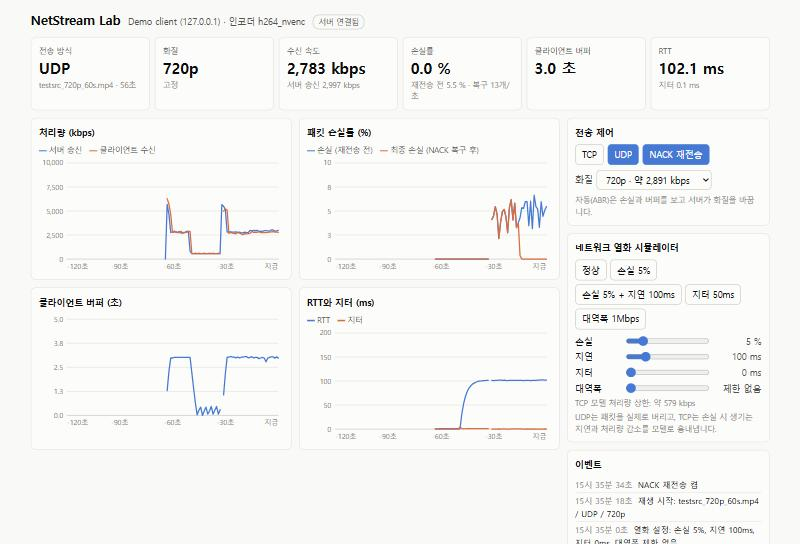

# NetStream Lab

Streams video from a PC to an Android phone over TCP or UDP, with a live dashboard that shows how the two protocols behave under packet loss, delay and limited bandwidth. Made for Assignment 4 of a Computer Networks course.

I started this because watching videos from my PC on my phone with VLC kept buffering. Jellyfin and similar programs already solve that, so for the assignment I focused on a different question: what actually changes when the same video goes over TCP instead of UDP? No HTTP library is used for the transport. The server and clients talk through a small protocol written directly on TCP and UDP sockets (see [PROTOCOL.md](PROTOCOL.md)).



Documents:

- [User guide](report/NetStreamLab_1_User_Guide.docx): what it does and how to use it
- [Technical report](report/NetStreamLab_2_Technical_Report.docx): design, measurements, use of AI
- [PROTOCOL.md](PROTOCOL.md): message and packet formats

## How it works

```
PC server (Python asyncio)                    Client (Android app / PC test client)
 video -> ffmpeg (H.264+AAC, MPEG-TS)
          |
          |-- TCP 9000  control       <---->  list, play, seek, quality, NACK, stats
          |-- TCP 9001  data (TCP)    ----->  player
          |-- UDP 9002  data (UDP)    ----->  reorder -> player
          `-- HTTP 9080 dashboard (browser)
```

- `pc/netstream/protocol.py`: message and packet format
- `pc/netstream/server/`: the server. `app.py` is the core, plus ffmpeg (`transcoder.py`), the impairment simulator (`impair.py`), ABR (`abr.py`) and the dashboard (`dashboard.py`)
- `pc/netstream/client/`: PC test client
- `pc/tests/e2e.py`: end-to-end test
- `pc/tools/`: measurement and figure scripts (figures need matplotlib)
- `android/`: Android app (Kotlin, Compose, Media3)
- `report/`: the two reports (docx), measurement data (csv) and figures
- `start_server.bat`: double-click launcher for the server

## Running it

You need Python 3.10 or later and ffmpeg. Nothing to install with pip.

```
winget install Gyan.FFmpeg
```

The easiest way is to double-click `start_server.bat`. It asks for the video folder, starts the server and opens the dashboard in the browser. (The reports say `source\pc` because they follow the layout of the submitted zip. In this repo it is just `pc`.)

To start the server by hand:

```
cd pc
python -m netstream.server --media "D:\Videos"
```

It prints the server IP and the dashboard address (http://127.0.0.1:9080). Allow Python through the Windows firewall the first time, otherwise the phone can't connect. The console output is in Korean.

PC test client:

```
cd pc
python -m netstream.client --host 127.0.0.1 --video 0
```

It plays in an ffplay window and prints stats every second. You can type commands like `tcp`, `udp`, `seek 30`, `nack on`, `quality auto` while it runs. With `--no-play` it only prints stats.

Android app: the built apk is on the [Releases page](https://github.com/ray1203/netstream-lab/releases/latest) ([direct download](https://github.com/ray1203/netstream-lab/releases/latest/download/NetStreamLab.apk)). Copy it to the phone and install it. To build it yourself, open the `android` folder in Android Studio, or run

```
cd android
.\gradlew.bat assembleDebug
```

The apk ends up in `app/build/outputs/apk/debug/`. Type the server IP in the app. The phone and the PC have to be on the same Wi-Fi (on the emulator use `10.0.2.2`).

Tests:

```
cd pc
python -m tests.e2e
```

## Demo

Keep the dashboard open on the PC and play a video on the phone.

1. Play over TCP. 0% loss, about 3 seconds of buffer.
2. Press "5% loss + 100 ms delay" on the dashboard. TCP drops to about 580 kbps, the buffer runs out and the video keeps stopping.
3. Switch to UDP. The rate is back to normal and it doesn't stop, but 5% loss shows up and the picture breaks sometimes.
4. Turn on NACK. Lost packets are recovered and the final loss is almost 0%.
5. Set the impairment back to normal, press "1 Mbps bandwidth" and set quality to auto. It goes from 720p down to 240p and the loss goes away.

## Results

Measured on one PC over loopback, 720p (about 2.9 Mbps), 30 seconds per run. Full tables and graphs are in the technical report.

| Condition | TCP | UDP | UDP + NACK |
|---|---|---|---|
| 5% loss | 2832 kbps, 0% loss | 2732 kbps, 4.94% loss | 2885 kbps, 0% loss |
| 5% loss + 100 ms delay | 585 kbps, stalled 20 of 30 s | 2706 kbps, 5.13% loss | 2879 kbps, 0% loss |
| 1 Mbps limit | stalled 19 of 30 s | 64.7% loss | 66.5% loss |

## Some design choices

**1316-byte payload.** An MPEG-TS packet is always 188 bytes, and 7 of them are 1316. With my 17-byte header, UDP (8) and IP (20) it's 1361 bytes, under the 1500-byte MTU, so there's no IP fragmentation. Losing one UDP packet also never breaks the TS packet boundaries.

**Pacing.** ffmpeg encodes as fast as it can. The server reads the PCR clock inside the TS stream and only sends up to 3 seconds ahead of real time, which becomes the client's buffer. At first it sent those 3 seconds all at once, which caused loss on its own under a bandwidth limit, so now it catches up at 2x speed at most.

**UDP receiving.** The client finds holes from the sequence numbers. Without NACK it waits 60 ms and skips. With NACK it sends the missing numbers over the control channel (TCP) and waits up to 0.6 s for the resend. Basically the part of TCP's retransmission that's actually needed, done by hand. Retransmission is capped at 25% of the data rate. Without that cap, a phone test under a 1 Mbps limit made the server send 12 Mbps of resends.

**ABR.** The client reports loss, buffer and received rate every second. Two bad reports in a row and the server drops to the quality that fits 70% of the received rate. Ten good ones and it goes up one step. If it has to come back down soon after going up, it waits twice as long next time.

## Limitations

- Loss in TCP mode isn't real loss. An app can't drop a TCP segment, and if one is lost the kernel resends it without the app noticing. So TCP mode only models the effects: head-of-line blocking while waiting for the resend, and lower throughput from congestion control using the Mathis formula `1.22 * MSS / (RTT * sqrt(p))`. UDP mode really drops packets.
- Random loss doesn't go away when quality goes down, so ABR doesn't help there. That's what NACK is for. ABR helps when bandwidth is the problem.
- With large jitter (50 ms), NACK asks for packets that were only late, not lost. Not fixed yet.
- The Android player restarts when quality changes, so the video pauses briefly.
- The simulator's delay can be off by about 15 ms because of the Windows timer.
- No server discovery, login or multiple viewers.
- Tested on an emulator (API 27) and one real phone (Galaxy S23 Ultra on campus Wi-Fi).

## Use of AI

I used Claude Code (an AI coding agent) for most of the implementation, testing and the first drafts of the documents. What I asked for and what came out of it is recorded in [AI_LOG.md](AI_LOG.md) (in Korean) and summarized in section 11 of the technical report.
